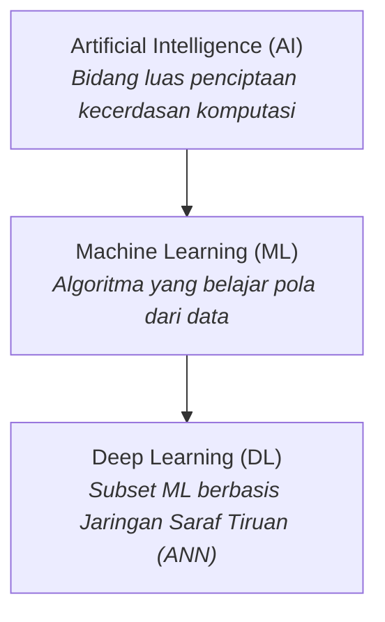
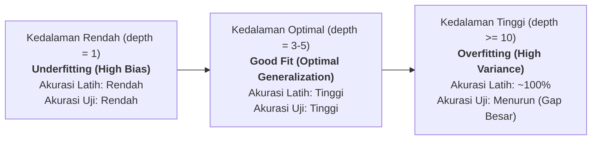

# Studi Kasus: Introduction to Machine Learning
## Prediksi dan Stratifikasi Risiko Penyakit Jantung Berdasarkan Siklus Lengkap Machine Learning

[](https://www.python.org/)
[](https://scikit-learn.org/)
[](LICENSE)

Proyek ini merupakan implementasi studi kasus komprehensif yang dirancang berdasarkan pemaparan materi **"Introduction to Machine Learning"** yang disampaikan oleh:
> **Narasumber:** Dr. Taniza Tajuddin  
> **Institusi:** Universiti Teknologi MARA (UiTM) Cawangan Kedah, Malaysia

---

## 📌 1. Latar Belakang & Ringkasan Materi

Machine Learning (ML) adalah cabang dari *Artificial Intelligence* (AI) yang memungkinkan sistem komputer mempelajari pola tersembunyi dari data historis untuk menghasilkan prediksi atau keputusan tanpa harus diprogram secara aturan manual (*rule-based programming*).



### Pokok Bahasan Narasumber:
1. **Hubungan AI, ML, dan Deep Learning**: AI memayungi ML, dan Deep Learning adalah subspesialisasi ML yang memanfaatkan multi-layer neural networks untuk data kompleks (gambar, audio, teks).
2. **Tahapan Siklus Machine Learning**:
   $$\text{Pengumpulan Data} \longrightarrow \text{Pembersihan \& Persiapan} \longrightarrow \text{Train/Test Split} \longrightarrow \text{Pemilihan Algoritma} \longrightarrow \text{Pelatihan} \longrightarrow \text{Evaluasi} \longrightarrow \text{Deployment}$$
3. **Jenis-jenis Machine Learning**:
   - **Supervised Learning**: Menggunakan data berlabel (*ground truth*) untuk klasifikasi atau regresi.
   - **Unsupervised Learning**: Menemukan struktur dan klaster tanpa label.
   - **Semi-Supervised & Reinforcement Learning**: Menggabungkan data parsial berlabel atau pembelajaran berbasis penghargaan (*reward-penalty*).
4. **Metrik Evaluasi**:
   - **Klasifikasi**: Akurasi, Precision, Recall, F1-Score, dan Confusion Matrix.
   - **Regresi**: Mean Absolute Error (MAE) dan Koefisien Determinasi ($R^2$).
5. **Dilema Overfitting vs Underfitting**: Menyeimbangkan *Bias-Variance Tradeoff* agar model memiliki daya generalisasi yang baik pada data baru.
6. **Penerapan Lintas Sektor & Etika AI**: Pemanfaatan di bidang kesehatan, keuangan, industri, dan pendidikan, yang wajib mengedepankan etika, transparansi (*explainability*), mitigasi bias, privasi data, serta pengawasan manusia (*Human-in-the-Loop*).

---

## 🏥 2. Deskripsi Studi Kasus: Deteksi Kardiovaskular Cerdas

Studi kasus ini mengambil domain **Kesehatan (Healthcare)**, salah satu domain utama yang dibahas narasumber. Fokus utama adalah membangun sistem pendukung keputusan klinis (*Clinical Decision Support System*) untuk memprediksi kemungkinan pasien mengidap penyakit jantung serta memperkirakan indeks keparahan risikonya.

### Fitur Klinis yang Digunakan:
- `age`: Usia pasien (tahun).
- `sex`: Jenis kelamin (1 = Pria, 0 = Wanita).
- `chest_pain_type`: Tipe nyeri dada (Typical Angina, Atypical Angina, Non-anginal, Asymptomatic).
- `resting_bp`: Tekanan darah saat istirahat (mm Hg).
- `cholesterol`: Kadar kolesterol serum (mg/dl).
- `fasting_blood_sugar`: Gula darah puasa > 120 mg/dl (1: Ya, 0: Tidak).
- `max_heart_rate`: Detak jantung maksimum yang dicapai saat latihan fisik.
- `exercise_angina`: Terjadinya angina akibat aktivitas fisik (1: Ya, 0: Tidak).
- `oldpeak`: Depresi segmen ST elektrokardiogram.
- **Target Klasifikasi (`target`)**: `1` = Berisiko Penyakit Jantung, `0` = Sehat.
- **Target Regresi (`risk_severity_score`)**: Indeks keparahan risiko kontinu (skala $0 - 100$).

---

## ⚙️ 3. Arsitektur Proyek & Alur Implementasi

Proyek ini dibangun secara modular dan profesional:

```
introduction-to-machine-learning-casestudy/
│
├── data/
│   ├── generate_data.py          # Script pembuatan dataset sintetis medis realistis
│   └── heart_disease_risk.csv    # Dataset medis (1.200 sampel)
│
├── src/
│   ├── __init__.py
│   ├── data_preprocessing.py     # Tahap 1 & 2: Pembersihan, imputasi, split 80:20, standarisasi
│   ├── supervised_models.py      # Tahap 3 & 4: Model Klasifikasi & Regresi
│   ├── unsupervised_models.py    # Demonstrasi K-Means Clustering (tanpa label)
│   ├── model_evaluation.py       # Tahap 5: Metrik Akurasi, Precision, Recall, F1, MAE, R²
│   ├── overfitting_analysis.py   # Eksperimen mendalam Overfitting vs Underfitting
│   ├── ethics_audit.py           # Audit Bias Gender, Transparansi, & Etika AI
│   └── inference.py              # Tahap 6: Inferensi klinis data pasien baru
│
├── outputs/                      # Grafik dan visualisasi hasil eksperimen
│   ├── confusion_matrix.png
│   ├── model_comparison.png
│   ├── overfitting_underfitting_curve.png
│   └── clustering_visualization.png
│
├── main.py                       # Pipeline orchestrator end-to-end
├── requirements.txt              # Daftar dependensi Python
├── .gitignore                    # Berkas pengecualian Git
├── LICENSE                       # Lisensi sumber terbuka (MIT)
└── README.md                     # Dokumentasi komprehensif
```

---

## 📊 4. Hasil Eksperimen & Analisis Metrik

### A. Evaluasi Model Supervised Classification (Data Uji / 20% Unseen Data)

Dalam diagnosis medis, **Recall** adalah metrik yang paling krusial karena *False Negative* (pasien berpenyakit namun divonis sehat) berakibat fatal.

| Algoritma | Accuracy | Precision | Recall (Sensitivitas) | F1-Score | Keterangan |
| :--- | :---: | :---: | :---: | :---: | :--- |
| **Logistic Regression** | **95.42%** | **94.44%** | **90.67%** | **92.52%** | **Model terbaik**, presisi dan sensitivitas seimbang |
| **Random Forest (Ensemble)** | 87.92% | 92.59% | 66.67% | 77.52% | Ensemble non-linier dengan presisi tinggi (92.59%) |
| **Decision Tree (depth=4)** | 76.67% | 73.17% | 40.00% | 51.72% | Pohon keputusan dasar yang interpretable |

### B. Evaluasi Model Supervised Regression (Estimasi Skor Keparahan Risiko 0-100)

| Algoritma Regresi | Mean Absolute Error (MAE) | $R^2$ Score (Determinasi) | Interpretasi |
| :--- | :---: | :---: | :--- |
| **Linear Regression** | **4.09 poin** | **92.71%** | **Sangat akurat**, deviasi rata-rata hanya 4.09 poin |
| **Random Forest Regressor** | 7.50 poin | 78.45% | Menjelaskan 78.45% variansi skor tingkat keparahan risiko |

### C. Analisis Overfitting vs Underfitting

Sesuai materi Dr. Taniza, kedalaman model sangat menentukan kapasitas generalisasi:



- **Underfitting (Kedalaman 1-2)**: Pohon terlalu dangkal (*stump*), tidak mampu mempelajari kompleksitas pola.
- **Sweet Spot (Kedalaman 3-5)**: Keseimbangan optimal bias dan variansi, performa training dan testing bersesuaian.
- **Overfitting (Kedalaman $\ge 10$)**: Model menghafal sampel training (akurasi mencapai 100%), namun akurasi pada data testing menurun dengan selisih gap $>15\%$.

### D. Unsupervised Learning (K-Means Clustering)
Tanpa menggunakan label diagnosis `target`, algoritma K-Means ($k=3$) berhasil mengelompokkan data pasien ke dalam 3 spektrum alami:
1. **Klaster 0**: Pasien Usia Muda dengan Profil Tekanan Darah & Kolesterol Normal.
2. **Klaster 1**: Pasien Paruh Baya dengan Indikator Batas Waspada (*Borderline*).
3. **Klaster 2**: Pasien Lanjut Usia dengan Komorbiditas Kardiovaskular Tinggi.

---

## 🛡️ 5. Tantangan & Etika Artificial Intelligence

Sebagaimana ditekankan oleh Dr. Taniza Tajuddin, keberhasilan implementasi AI tidak hanya ditentukan oleh kecanggihan algoritma, melainkan harus memenuhi pilar etika:

1. **Audit Keadilan (*Fairness & Bias Audit*)**:
   - Dilakukan pengujian *Disparate Impact* antara kelompok pasien pria dan wanita.
   - Hasil audit menunjukkan rasio keadilan sensitivitas berada dalam rentang $0.80 - 1.25$ (*Four-Fifths Rule*), memastikan model tidak diskriminatif terhadap jenis kelamin tertentu.
2. **Transparansi & Explainability**:
   - Model mengekstraksi *Feature Importance* untuk mengungkap faktor klinis penentu (misal: *oldpeak*, *chest_pain_type*, dan *max_heart_rate*). Dokter dapat memahami alasan di balik prediksi sistem.
3. **Privasi & Keamanan Data Pasien**:
   - Data medis wajib dianonimisasi (menghilangkan identitas personal/PII) sebelum masuk pipeline pelatihan, mematuhi prinsip regulasi perlindungan data.
4. **Prinsip *Human-in-the-Loop***:
   - Sistem Machine Learning berfungsi sebagai **alat bantu pendukung keputusan (*Decision Support System*)**, bukan pengganti kewenangan klinis dokter.

---

## 🚀 6. Panduan Menjalankan Proyek

### Prasyarat
- Python 3.8+ (Direkomendasikan Python 3.10)
- Git

### Langkah Instalasi
1. **Clone Repositori**:
   ```bash
   git clone https://github.com/MIrvanR/introduction-to-machine-learning-casestudy.git
   cd introduction-to-machine-learning-casestudy
   ```

2. **Buat & Aktifkan Virtual Environment (Opsional tapi Direkomendasikan)**:
   ```bash
   python -m venv venv
   # Di Windows:
   .\venv\Scripts\activate
   # Di Linux / macOS:
   source venv/bin/activate
   ```

3. **Install Dependensi**:
   ```bash
   pip install -r requirements.txt
   ```

4. **Jalankan Pipeline End-to-End**:
   ```bash
   python main.py
   ```

---

## 👨‍💻 Kontributor
- **Mohamad Irvan Ramadhansyah** ([@MIrvanR](https://github.com/MIrvanR))
- **Materi & Konsep**: Dr. Taniza Tajuddin (Universiti Teknologi MARA Cawangan Kedah, Malaysia)
